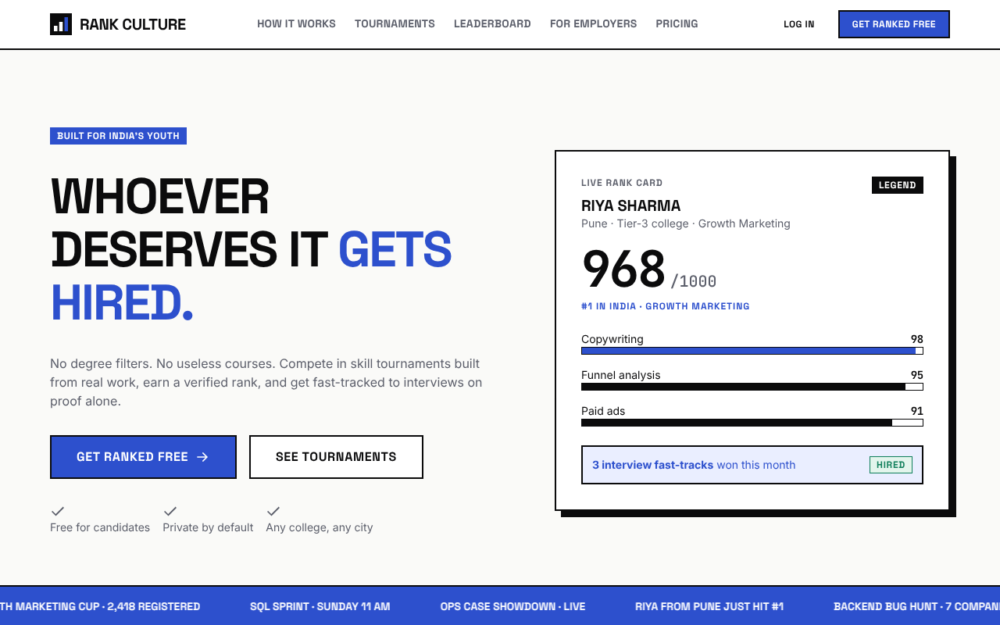
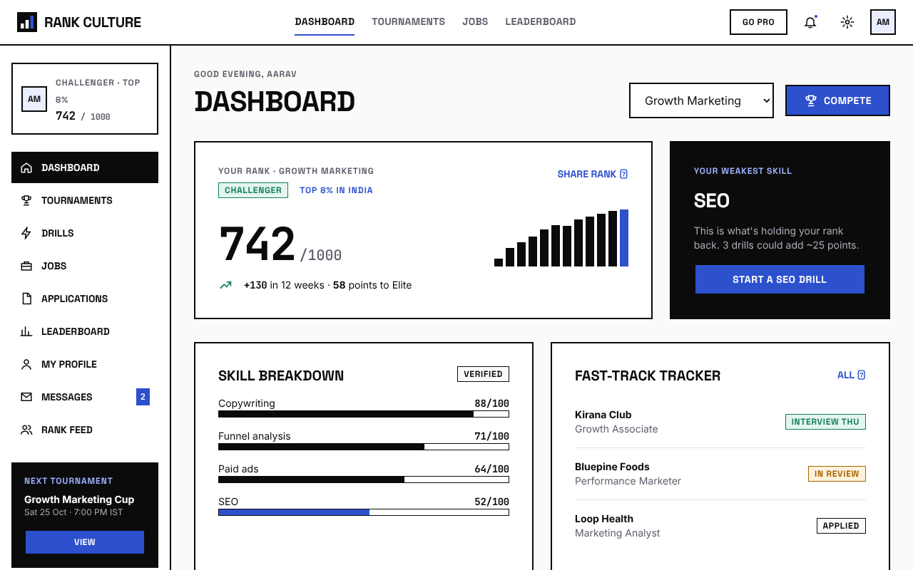
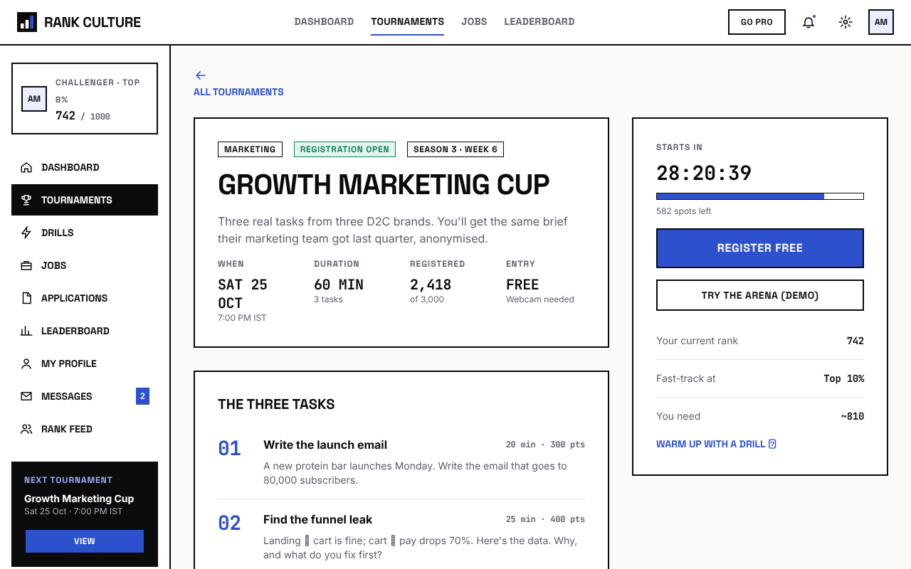
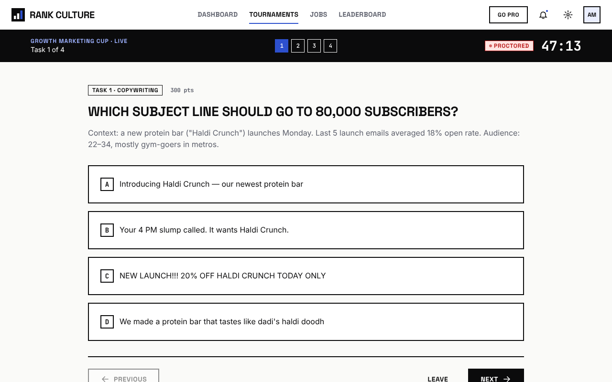
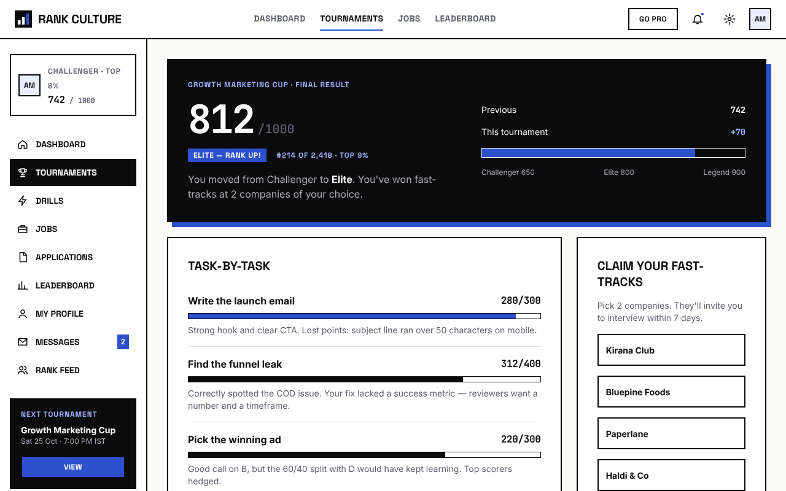
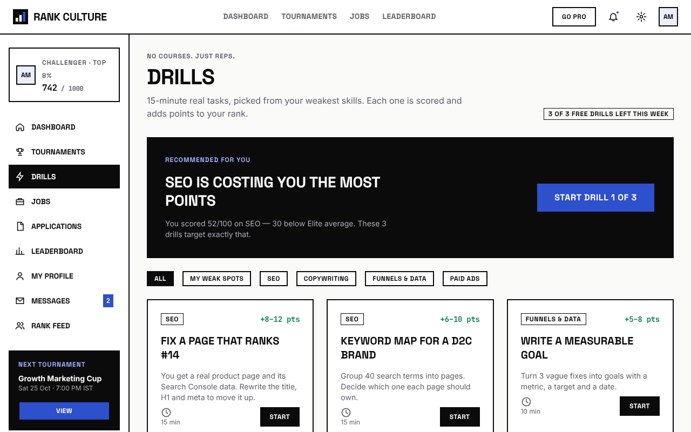
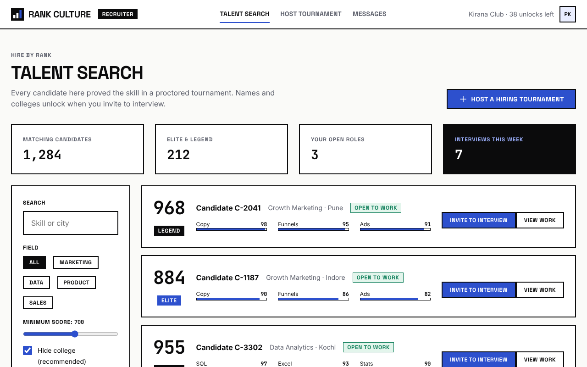
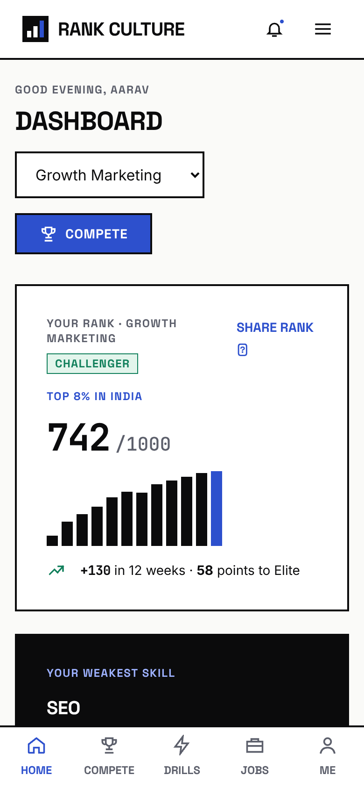

<div align="center">


# Rank Culture

**Whoever deserves it gets hired.**

A merit-first hiring platform for India's youth. Compete in skill tournaments built from real work, earn a verified rank out of 1000, and get fast-tracked to interviews on proof — not on degrees, connections or certificates.

[**Live site →**](https://rankculture.in) &nbsp;·&nbsp; [5-minute demo path](#demo-path) &nbsp;·&nbsp; [Security & testing](#security--testing)



</div>

---

## The problem

Every year about 1 crore young Indians enter the job market. Most are filtered out by college name, a CGPA cut-off or a keyword scanner before anyone sees what they can do. The fix on offer is usually another paid course — a certificate recruiters don't trust either.

## The idea

Bring **rank culture** — the way sport works — to hiring. Nobody asks which college a champion went to.

| | Traditional hiring | Rank Culture |
|---|---|---|
| Filter | College name, CGPA | Verified score only. College hidden until interview |
| Upskilling | ₹40,000 certificate courses | 15-minute **drills** on real tasks, only where your rank is weak |
| Applying | 300 applications, 2 replies | Top ranks skip screening and go straight to interview |
| Proof | Self-reported resume | Every point earned in a proctored tournament |

### How it works

1. **Compete** — weekly tournaments built from tasks the role actually does (write the launch email, find the funnel leak, pick the winning ad), plus live 1v1 and group battles every day. Free.
2. **Rank up** — a verified score out of 1000 and a tier: Rookie → Contender → Challenger → Elite → Legend.
3. **Get hired** — top finishers win interview fast-tracks that skip resume screening. (Pilot: the companies on the jobs board are fictional until partners sign on.)

### Business model

Nothing is for sale during the pilot. Planned:

- **Candidates:** competing stays free. Pro at ₹199/month (₹99 for students) for personal drill plans and deeper score analytics.
- **Employers:** free starter tier, Growth at ₹14,999/month (candidate unlocks + hosted tournaments), Enterprise custom.
- **Campus:** free private tournaments for placement cells.

## Screens

| Dashboard | Tournament details |
|---|---|
|  |  |
| **Live arena** | **Results & rank-up** |
|  |  |
| **Drills (replace courses)** | **Recruiter talent search** |
|  |  |

<p align="center"></p>

**Live screens:** marketing site, sign-up and 3-step onboarding, dashboard, tournaments, live arena, results, drills, battles (quick match, private rooms, hosted events, knockouts), jobs, applications, leaderboards, profile, settings and support. Messages, notifications, rank feed, company reviews and the recruiter console are sample screens (clearly bannered) and aren't linked from the app yet.

### Demo path

Landing → Sign up → Onboarding 1–3 → Dashboard → Tournament details → Live arena → Results → Drills → Jobs → Apply → Applications → Recruiter talent search

## Design system

Started as an MVP in Google Stitch, then standardised so nothing can drift between screens:

- **One logo** — a 28px mark (three rising bars, the last one blue) + the wordmark in Space Grotesk Bold.
- **Three fonts** — Space Grotesk (headings, labels, buttons), Inter (body), JetBrains Mono (scores and timers only).
- **Seven text sizes** — 64 · 40 · 28 · 20 · 16 · 14 · 12. The build **fails** if any page uses another size, a raw font family, or links to a page that doesn't exist.
- **Colour** — ink `#0B0B0C`, paper `#FAFAF8`, blue `#2D50CD`, green `#12805C`, amber `#A86200`, red `#BA1A1A`.

The same system lives in Figma as colour variables, 11 text styles and Logo / Button / Badge components.

## Tech

Plain HTML, CSS and JavaScript — no framework, no dependencies at runtime.

```
src/
  layout.js            logo, icons, header, sidebar, footer — the single source of the shell
  pages-public.js      landing, how it works, tournaments, leaderboard, employers, pricing, legal, 404
  pages-auth.js        sign up, log in, reset password, onboarding 1–3
  pages-app.js         dashboard, tournaments, details, live arena, results, drills
  pages-app2.js        jobs, applications, profile, messages, notifications, feed, settings, states
  pages-recruiter.js   talent search, host a tournament (sample screens)
  rc.js / rc-battle.js auth, route guards and live data (Supabase) for every app screen
  browser.js           renders any page in the browser from the same generators
assets/
  styles.css           the design system (tokens + components)
  app.js               interactions: filters, tabs, modals, onboarding, arena, forms
build.js               builds, lints the design system, and emits the deploy bundle
```

```bash
npm run build      # → dist/ (per-page), dist-static/ (full HTML), deploy/ (what Vercel serves)
npm run test:db    # replays every migration on PGlite and attacks it as anon / other users (93 checks)
npm run test:e2e   # every page, button and core flow in Chrome, signed in/out, desktop/mobile
```

Deployed on Vercel: `node build.js`, output directory `deploy/`. Every URL is rewritten to one page stub that renders the right screen.

## Security & testing

- **Database:** Supabase Postgres with row-level security on every table. Scores, ratings, battle answers and applications are written only by server functions; answer keys never reach the browser. Tournament prompts unlock only after your own timer starts. Optional TOTP two-step verification is enforced in the database. Least-privilege grants (no direct writes to scores or applications).
- **Browser:** strict Content-Security-Policy with no `unsafe-inline` or `unsafe-eval` for scripts (inline scripts are allowed by SHA-256 hash, generated at build), HSTS, `X-Frame-Options: DENY`, `nosniff`, tight Referrer and Permissions policies. All user content is escaped before rendering; the build fails on inline event handlers or `javascript:` links.
- **Sign-in:** email + password (8+ characters, letters and digits) with an emailed one-time code to confirm new accounts; password reset by one-time code to email, or SMS once a phone provider is connected in Supabase; GitHub and Google. Email templates live in `supabase/email-templates/`.
- **Tests:** `supabase/tests/security.test.mjs` (database: isolation, privilege, integrity, rate limits, account deletion) and `tests/e2e.py` (UI: 4 crawl modes, click-through of every control, 15 end-to-end flows against a mocked API).

## Status

Pilot. Accounts, tournaments, battles, leaderboards, drills, applications and support messages are live. Companies on the jobs board are fictional until real hiring partners join, and applications aren't sent anywhere yet — the site says so where it matters.

## Author

**Nakul Chaturvedi** — [LinkedIn](https://www.linkedin.com/in/nakulchaturvediwork) · [GitHub](https://github.com/nakulchaturvediwrk)

© 2026 Nakul Chaturvedi. All rights reserved.
