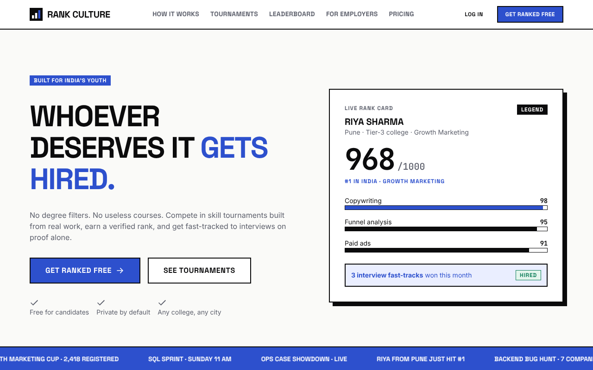
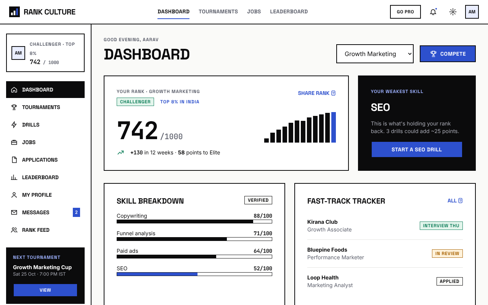
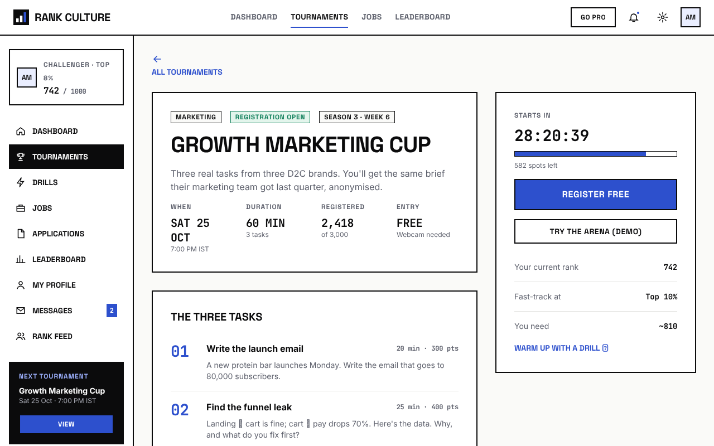
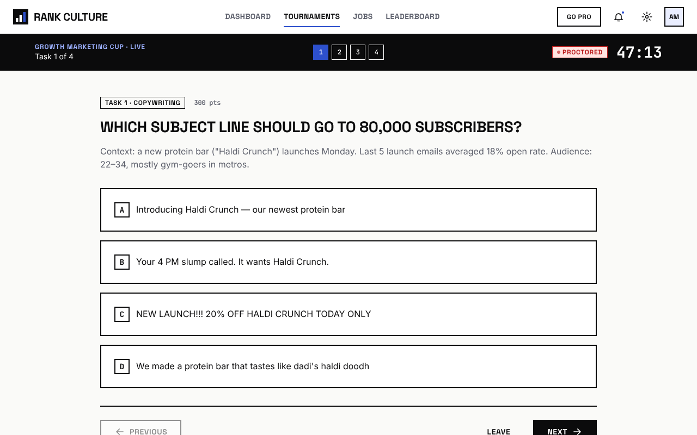
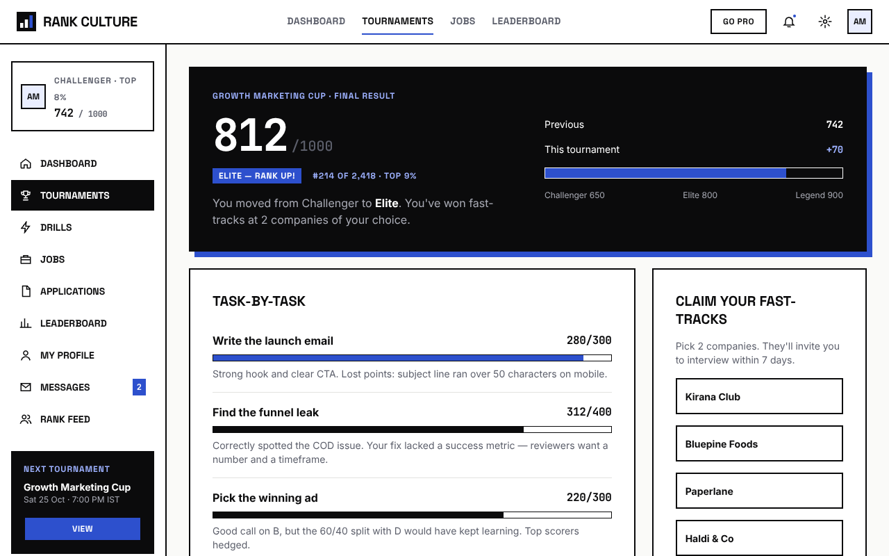
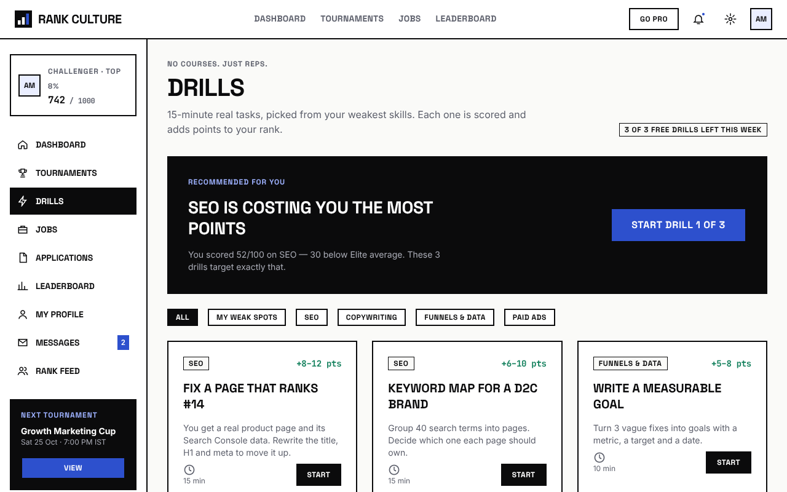
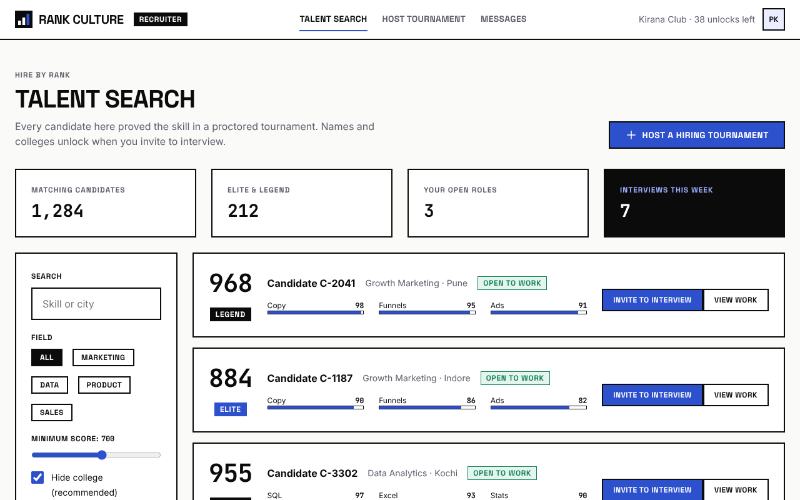
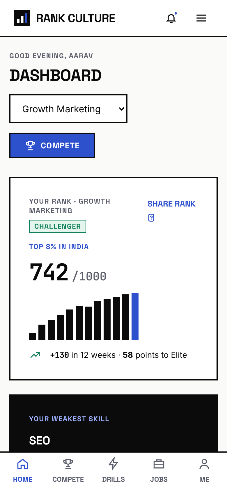

<div align="center">


# Rank Culture

**Whoever deserves it gets hired.**

A merit-first hiring platform for India's youth. Compete in skill tournaments built from real work, earn a verified rank out of 1000, and get fast-tracked to interviews on proof — not on degrees, connections or certificates.

[**Live prototype →**](https://rank-culture.vercel.app) &nbsp;·&nbsp; [Screen map (all 39 screens)](https://rank-culture.vercel.app/map.html) &nbsp;·&nbsp; [5-minute demo path](#demo-path)



</div>

---

## The problem

Every year about 1 crore young Indians enter the job market. Most are filtered out by college name, a CGPA cut-off or a keyword scanner before anyone sees what they can do. The fix on offer is usually another paid course — a certificate recruiters don't trust either.

## The idea

Bring **rank culture** — the way sport works — to hiring. Nobody asks which college a champion went to.

| | Traditional hiring | Rank Culture |
|---|---|---|
| Filter | College name, CGPA | Verified score only. College hidden until interview |
| Upskilling | ₹40,000 certificate courses | 15-minute **drills** on real tasks, only where your rank is weak |
| Applying | 300 applications, 2 replies | Top ranks skip screening and go straight to interview |
| Proof | Self-reported resume | Every point earned in a proctored tournament |

### How it works

1. **Compete** — weekly tournaments built with hiring partners from tasks their team actually does (write the launch email, find the funnel leak, pick the winning ad). 40–90 minutes, free.
2. **Rank up** — a verified score out of 1000 and a tier: Rookie → Contender → Challenger → Elite → Legend.
3. **Get hired** — top finishers win interview fast-tracks; recruiters hire straight from the leaderboard.

### Business model

- **Candidates:** free forever. Pro at ₹199/month (₹99 for students) for unlimited drills, detailed score breakdowns and a top-10% interview guarantee.
- **Employers:** free starter tier, Growth at ₹14,999/month (candidate unlocks + hosted tournaments), Enterprise custom.
- **Campus:** free private tournaments for placement cells, Pro for every student at ₹49.

## Screens

| Dashboard | Tournament details |
|---|---|
|  |  |
| **Live arena** | **Results & rank-up** |
|  |  |
| **Drills (replace courses)** | **Recruiter talent search** |
|  |  |

<p align="center"></p>

**39 screens in total:** marketing site, sign-up and 3-step onboarding, candidate app (dashboard, tournaments, live arena, results, drills, jobs, applications, leaderboard, profile, messages, notifications, rank feed, company reviews, settings), employer side (talent search, host a hiring tournament) and system states (loading, empty, offline mid-tournament, 404).

### Demo path

Landing → Sign up → Onboarding 1–3 → Dashboard → Tournament details → Live arena → Results → Drills → Jobs → Apply → Applications → Recruiter talent search

## Design system

Started as an MVP in Google Stitch, then standardised so nothing can drift between screens:

- **One logo** — a 28px mark (three rising bars, the last one blue) + the wordmark in Space Grotesk Bold.
- **Three fonts** — Space Grotesk (headings, labels, buttons), Inter (body), JetBrains Mono (scores and timers only).
- **Seven text sizes** — 64 · 40 · 28 · 20 · 16 · 14 · 12. The build **fails** if any page uses another size, a raw font family, or links to a page that doesn't exist.
- **Colour** — ink `#0B0B0C`, paper `#FAFAF8`, blue `#2D50CD`, green `#12805C`, amber `#A86200`, red `#BA1A1A`.

The same system lives in Figma as colour variables, 11 text styles and Logo / Button / Badge components.

## Tech

Plain HTML, CSS and JavaScript — no framework, no dependencies at runtime.

```
src/
  layout.js            logo, icons, header, sidebar, footer — the single source of the shell
  pages-public.js      landing, how it works, tournaments, leaderboard, employers, pricing, legal, 404
  pages-auth.js        sign up, log in, reset password, onboarding 1–3
  pages-app.js         dashboard, tournaments, details, live arena, results, drills
  pages-app2.js        jobs, applications, profile, messages, notifications, feed, settings, states
  pages-recruiter.js   talent search, host a tournament, screen map
  browser.js           renders any page in the browser from the same generators
assets/
  styles.css           the design system (tokens + components)
  app.js               interactions: filters, tabs, modals, onboarding, arena, forms
build.js               builds, lints the design system, and emits the deploy bundle
```

```bash
npm run build      # → dist/ (per-page), dist-static/ (full HTML), deploy/ (what Vercel serves)
```

Deployed on Vercel: `node build.js`, output directory `deploy/`. Every URL is rewritten to one page stub that renders the right screen.

## Status

This is a **clickable prototype** for feedback from faculty and mentors — not a production app. Tournament data, rankings, companies and metrics shown are illustrative; company names are fictional.

## Author

**Nakul Chaturvedi** — [LinkedIn](https://www.linkedin.com/in/nakul-chaturvedi-142588248) · [GitHub](https://github.com/nakulchaturvediwrk)

© 2026 Nakul Chaturvedi. All rights reserved.
